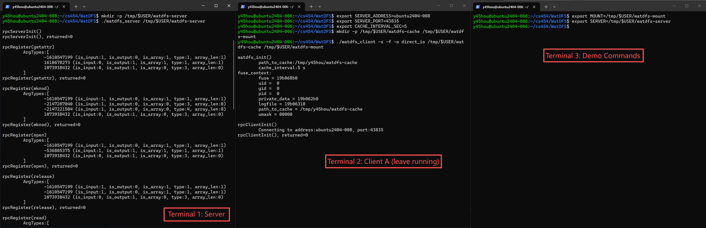
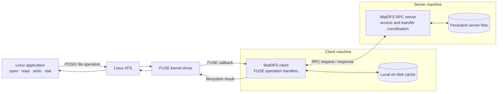
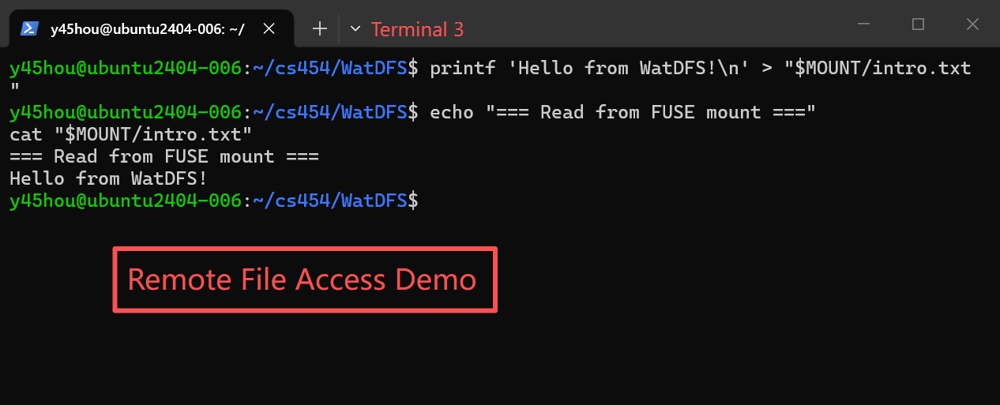
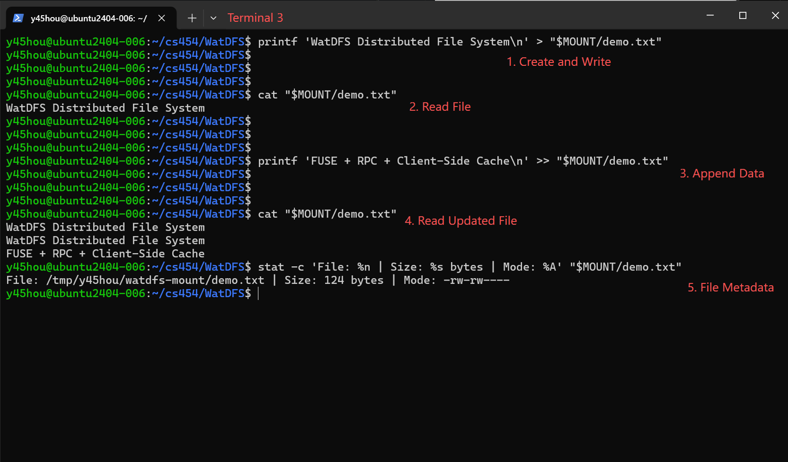
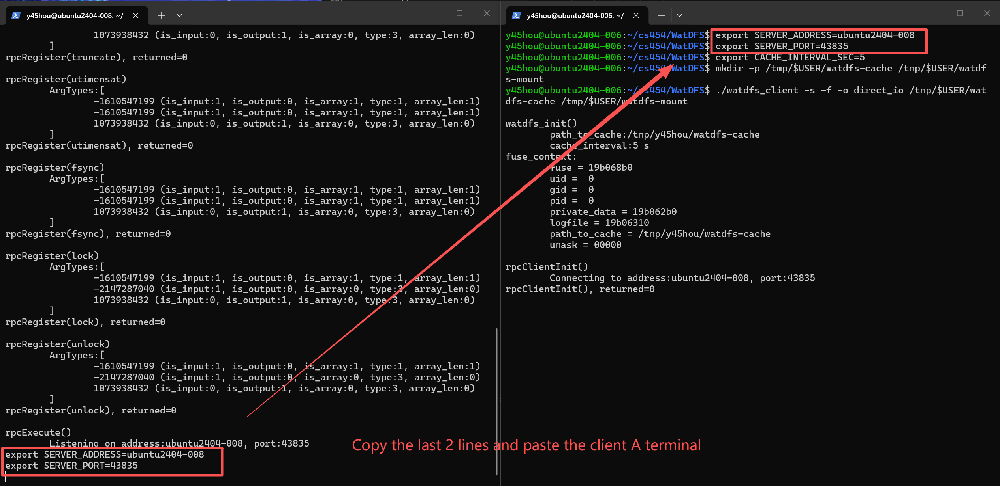

# WatDFS — A Simplified Distributed File System

**A FUSE-based distributed file system in C/C++, featuring RPC communication, client-side caching, consistency checks, and multi-client concurrency control.**

WatDFS makes files stored on a remote server accessible through an ordinary Linux mount point. Applications can use familiar file operations such as `open`, `read`, `write`, and `close` without managing network communication themselves. Behind the mount point, a FUSE client coordinates with a remote server over RPC, maintains a local on-disk cache, and synchronizes updates while enforcing access restrictions across clients.

Developed for the University of Waterloo's **CS 454/654: Distributed Systems**, WatDFS combines a remote-access foundation with an **upload/download and client-side caching model**. The result is a compact exploration of filesystem transparency, remote procedure calls, cache consistency, and synchronization.



*Figure 1: An application reads a file through the WatDFS mount point while the data is backed by the remote server.*

## Highlights

- **Transparent file access via FUSE** — Exposes remote files through standard Linux filesystem operations without kernel modifications or application-level RPC code.
- **RPC-based client–server design** — Translates filesystem operations into remote requests to a centralized server.
- **On-disk client caching** — Downloads files on demand and executes file operations against locally cached copies.
- **Timeout-based cache validation** — Uses a configurable freshness interval and file modification timestamps to decide whether to reuse or refresh cached data.
- **Write-back synchronization** — Propagates local updates to the server as required by the freshness policy, `fsync`, and file release.
- **Multi-client access coordination** — Supports concurrent readers while preventing conflicting writers from opening the same file.
- **Atomic file transfers** — Uses reader–writer synchronization around uploads and downloads to avoid exposing partially transferred file contents.

## Architecture

WatDFS separates application-facing filesystem operations from networked storage and coordination:

```text
                     Linux Applications
                   (open / read / write)
                              |
                         Linux VFS
                              |
                             FUSE
                              |
                  +-----------v-----------+
                  |     WatDFS Client      |
                  |  - FUSE operations     |
                  |  - Open-file tracking  |
                  |  - Cache validation    |
                  |  - Local disk cache    |
                  +-----------+-----------+
                              |
                         RPC requests
                              |
                  +-----------v-----------+
                  |     WatDFS Server      |
                  |  - RPC handlers        |
                  |  - Access coordination |
                  |  - Transfer locks      |
                  |  - File I/O            |
                  +-----------+-----------+
                              |
                    Persistent Files
```

Each client has its own FUSE mount and local cache. Multiple client instances can connect to a shared server, which manages persistent files and cross-client coordination.

## Core Features

### 1. Filesystem Operations Through FUSE

WatDFS implements the userspace handlers behind common Linux file operations, allowing existing command-line applications to interact with the mount as though they were working with regular files.



*Figure 2: System Architecture*

**Note:** *Standard filesystem calls travel through VFS and FUSE to the WatDFS client. The client serves operations from its local cache when possible and communicates with the shared server over RPC for file transfers, metadata, and coordination.*

| Category | Supported operations |
| --- | --- |
| File lifecycle | `mknod`, `open`, `release` |
| Data access | `read`, `write`, `truncate` |
| Metadata | `getattr`, `utimensat` |
| Synchronization | `fsync` |

The implementation integrates these operations with local filesystem calls and RPC, depending on the current file state and caching requirements.



*Figure 3 & 4: Creating, reading, and inspecting a remote-backed file through standard Linux commands.*

### 2. RPC Communication and Remote Storage

Filesystem requests cross a defined client–server boundary:

1. An application issues a filesystem operation against the FUSE mount.
2. The WatDFS client services the request locally when possible or invokes an RPC operation.
3. The server performs the requested file or coordination operation against its local filesystem.
4. The client receives any metadata, file data, or error result and returns the appropriate filesystem response.

In the final upload/download design, operations on an opened file are generally performed on its **local cached copy** rather than sending a network round-trip for every byte-level read or write.

### 3. Client-Side Caching and Consistency

WatDFS stores cached file contents **on disk at the client**, rather than as a separate in-memory filesystem cache.

- **File open:** Acquires the necessary access state and makes a local copy available, downloading the server version when appropriate.
- **Reads:** Reuse the cached file while it is considered fresh. When the interval expires, modification timestamps are checked against the server to determine whether a refresh is needed.
- **Writes and truncation:** Update the local file and follow a freshness-based write-back policy.
- **`fsync` and release:** Explicit synchronization flushes changes to the server; writable files are uploaded on release, while cached files remain on disk.

The freshness interval is configurable through `CACHE_INTERVAL_SEC`. This is a **timeout-based consistency strategy**, not a guarantee that different clients always see an update instantaneously.


### 4. Concurrency Control and Atomic Transfers

The server coordinates concurrent access across multiple WatDFS clients:

- **Concurrent reads:** Multiple clients may read the same server-backed file.
- **Single-writer access:** An additional write-mode open is rejected while another client holds the file open for writing.
- **Per-client open tracking:** A client disallows incompatible duplicate opens of the same file in its own instance.
- **Atomic uploads/downloads:** Reader–writer locks coordinate file transfers so a reader does not observe a partially uploaded file.

These mechanisms illustrate practical distributed synchronization without attempting to implement a general-purpose distributed transaction or replication protocol.


## Validation and Performance

The finished implementation passed the course's automated tests. For a portfolio-oriented demonstration, the following independent checks show how the system behaves from the application side:

| Test | What it validates | Result |
| --- | --- | --- |
| Basic file operations | End-to-end file I/O through FUSE and RPC | Passed course tests |
| Binary file integrity | Exact transfer of arbitrary byte sequences | Add screenshot |
| Client caching | End-to-end read latency before and after local cache population | Add measurements |
| Cache freshness | Updated server contents become visible following validation | Passed course tests; add demo |
| Multi-client access | A conflicting writer is rejected | Passed course tests; add demo |
| Atomic transfer | Readers do not consume a partial upload | Passed course tests |


### Cold vs. Warm Reads

The cache is designed to avoid redundant content downloads when a file can be served from a valid local copy. A useful end-to-end benchmark compares the first read of a previously uncached file with subsequent reads while its cache entry remains valid.

| Measurement | Value |
| --- | --- |
| File size | *To measure* |
| Cache interval | *To record* |
| Cold read latency | *To measure* |
| Warm read latency (median) | *To measure* |
| Relative latency improvement | *To calculate* |


*Performance note:* These are end-to-end timings, including FUSE, file operations, and local storage effects. They should not be interpreted as standalone network RPC latency. The table above intentionally contains no fabricated measurements.

## Technology Stack

- **Language:** C / C++ systems programming interfaces
- **Platform:** Linux
- **Filesystem integration:** FUSE (Filesystem in Userspace)
- **Communication:** Remote Procedure Calls (RPC)
- **Concurrency:** Reader–writer synchronization and per-file access tracking
- **Storage:** Local filesystem-backed server storage and client-side disk caches
- **Build system:** GNU Make

## Build and Run

Requires the Linux/FUSE environment and supporting RPC/FUSE libraries used by this implementation. Run the commands from the directory containing the project's `Makefile`.

```bash
make clean all
```

**Terminal 1 — Start the server:**

```bash
mkdir -p /tmp/$USER/watdfs-server
./watdfs_server /tmp/$USER/watdfs-server
```

The server prints `SERVER_ADDRESS` and `SERVER_PORT`. In a separate terminal, use those values:

**Terminal 2 — Mount a client:**

```bash
export SERVER_ADDRESS=<hostname-from-server-output>
export SERVER_PORT=<port-from-server-output>
export CACHE_INTERVAL_SEC=5

mkdir -p /tmp/$USER/watdfs-cache /tmp/$USER/watdfs-mount
./watdfs_client -s -f -o direct_io \
  /tmp/$USER/watdfs-cache \
  /tmp/$USER/watdfs-mount
```

**Terminal 3 — Access a remote-backed file:**

```bash
printf 'Hello from WatDFS!\n' > /tmp/$USER/watdfs-mount/hello.txt
cat /tmp/$USER/watdfs-mount/hello.txt
stat /tmp/$USER/watdfs-mount/hello.txt
```



*Figure 5: Initiate client and server.*


Multiple clients can connect to the same server using separate cache and mount directories. WatDFS supports the designated file operations rather than the full POSIX API; directory management is outside its scope.

## Scope and Design Trade-offs

WatDFS is a distributed filesystem prototype focused on **filesystem transparency, RPC, client-side caching, timeout-based consistency, and concurrency**. It uses one central backing server and does not implement replication, consensus, or full POSIX filesystem compatibility. Its caching model trades immediate cross-client freshness for reduced file-transfer overhead.

## Acknowledgments

Developed for **CS 454/654 — Distributed Systems, University of Waterloo**. The project builds on course-provided FUSE integration, RPC support, and synchronization components. The WatDFS client/server functionality was completed as part of the course project.
