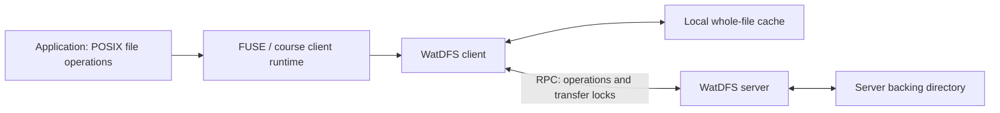

# WatDFS — A Simplified Distributed File System

A C++ distributed filesystem built for the University of Waterloo's CS 454/654 Distributed Systems course. Applications access remote files through ordinary filesystem calls, while a FUSE client manages a local whole-file cache and communicates with a central server through RPC.

The main implementation combines remote file access, timeout-based cache validation, writeback, and coordinated file transfers. An earlier remote-access implementation is retained as a performance baseline.

## Architecture



On open, the client obtains a server file handle and downloads a complete file into its cache. Reads and writes then use the local copy. After the configured freshness interval, subsequent operations check modification times and refresh or upload the file as appropriate. Explicit `fsync` and writable-file release upload the cached contents to the server.

## Implemented features

| Capability | Implementation |
| --- | --- |
| Transparent file access | FUSE callbacks for `getattr`, `mknod`, `open`, `release`, `read`, `write`, `truncate`, `fsync`, and timestamp updates |
| Remote operations | RPC argument marshaling, server dispatch, file handles, offset-based I/O, and negative-errno propagation |
| Large transfers | Files transferred in chunks respecting the RPC library's 65,535-byte array limit |
| Whole-file caching | Local disk copies serve reads and writes after the initial download |
| Freshness checks | Configurable timeout and modification-time comparison; stale read-only copies are downloaded again |
| Writeback | Operation-triggered writeback after expiry, explicit `fsync`, and writable-file close |
| Open coordination | Multiple readers and at most one writer per file across clients; duplicate opens in one client are rejected |
| Transfer coordination | Per-file reader/writer locks coordinate complete uploads and downloads; the submitted lock implementation gives waiting writers priority |
| Comparison baseline | Earlier implementation forwards file operations to the server without the whole-file client cache |

Readers may coexist with a writer. Writer admission and transfer locking are separate mechanisms: admitting a writer does not block every reader for the lifetime of the open file.

## Build and run

Requires a compatible Linux environment, a C++14 compiler, Make, `pkg-config`, FUSE **2** development files, and the bundled course static libraries. Python 3 is used only by the validation tools.

```bash
git clone https://github.com/Sirius-Hou/WatDFS.git
cd WatDFS
make clean all
make -C baseline clean all
```

Use `make all`: the inherited default target does not build the client executable.

1. Start `watdfs_server` with a dedicated backing directory.
2. Export the `SERVER_ADDRESS` and `SERVER_PORT` printed by that server.
3. Set `CACHE_INTERVAL_SEC` and start `watdfs_client -s -f -o direct_io CACHE MOUNT`.
4. Access known file paths inside the mount with ordinary file operations.

See the [school-server runbook](docs/RUNNING.md) for complete terminal-by-terminal commands, multi-client checks, and safe shutdown. See the [benchmark guide](docs/BENCHMARKING.md) for reproducible comparisons and screenshot suggestions.

## Repository layout

```text
.
├── watdfs_client.cpp / .h    Cached client implementation and interface
├── watdfs_server.cpp        RPC server and per-file coordination
├── rw_lock.cpp / .h         Submitted reader/writer lock
├── rpc.h, debug.h           Course interfaces and logging support
├── Makefile
├── baseline/                Original remote-access implementation
├── lib/                     Course-provided RPC and FUSE runtime archives
├── tests/                   Functional checks, benchmark, and tooling self-tests
└── docs/                    Runbook, benchmarking, provenance, and validation
```

The [provenance notes](docs/PROVENANCE.md) distinguish the implementation work from the course framework. The RPC transport and FUSE entry-point libraries were provided by the course; they were not implemented from scratch for this project.

## Results and validation

Both course submissions passed all course tests at the time of submission, as reported by the author. That historical result is separate from the checks performed while preparing this repository.

Current checks and their environment are recorded in [Validation](docs/VALIDATION.md). Performance measurements on the school servers are pending. This repository includes tools to collect actual results rather than a claimed speedup without measurements.

## Design boundaries

- This is an educational, single-server filesystem, not a production storage service.
- The supported interface covers basic file operations, not directory listing/creation, rename, or unlink through the mount. Use known filenames; do not use `ls` on the mount as a health check.
- Each client runs single-threaded (`-s`); multiple client instances can connect to a server.
- Every open downloads the file again. Cache reuse applies while a file remains open, not indefinitely across separate `cat` commands.
- Cache expiry is checked during operations, not by a background refresh thread. Visibility is timeout-based rather than strict POSIX coherence across clients.
- Transfer locks coordinate participating clients. They do not provide transactional rollback, crash recovery, replication, or recovery of locks after a client failure. Direct edits to the backing directory bypass that coordination.
- `close` may return before FUSE completes `release`; use `fsync` when an explicit synchronization point is needed.
- Whole-file transfers trade network cost at open/writeback for cheaper repeated local access. They can be expensive for large files or short-lived opens.
- Bundled static libraries depend on the course runtime ABI. Compatibility must be checked on the intended Linux host.

No blanket open-source license is applied to course-provided components; see [Provenance](docs/PROVENANCE.md).
